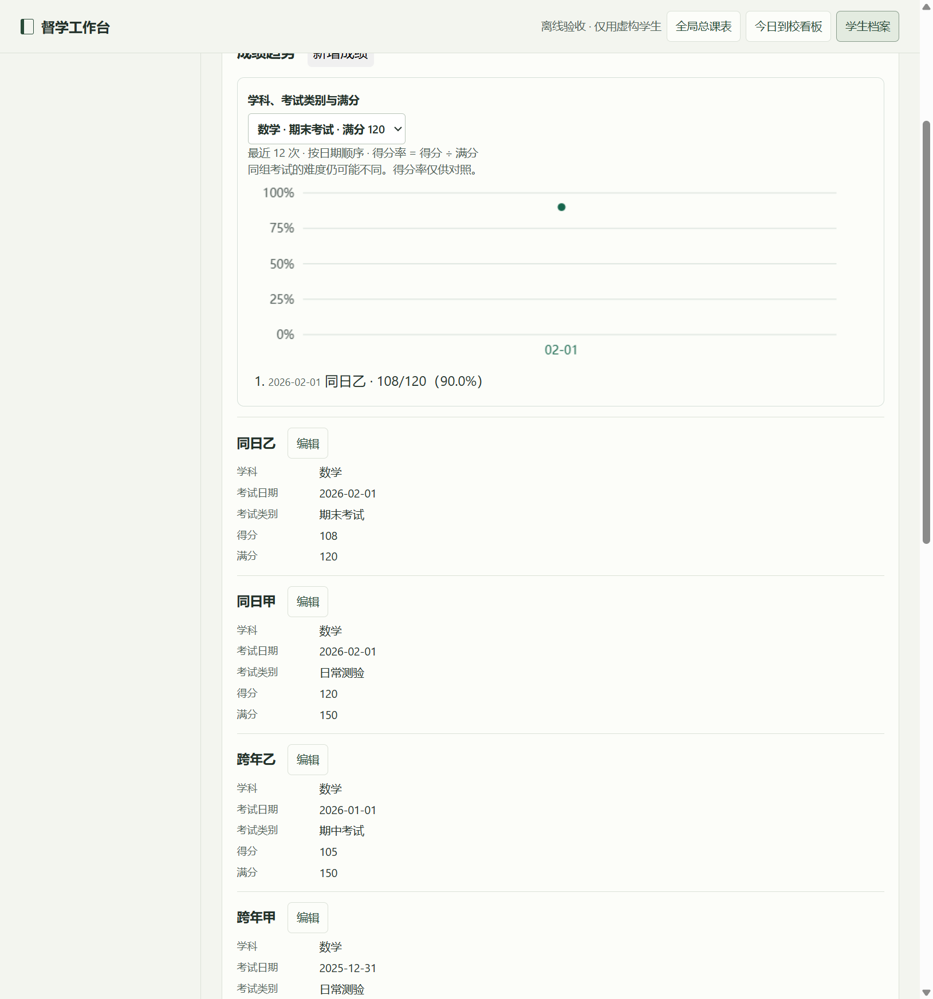
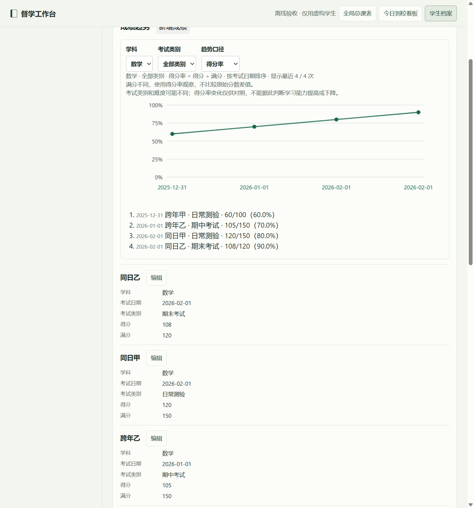

# Phase 1A 成绩对比修复与验收

基于 main `a1e5a3b49fe50a8a7db75d219d351e82f9680911` 隔离开发。只改变成绩趋势的筛选、计算和展示；正式部署保持 HOLD。

## 问题与最终行为

原组件以学科、考试类别、满分强制拆组。虚构学生的数学成绩为 60/100（日常测验）、105/150（期中）、120/150（日常测验）、108/120（期末）时，默认只显示最后一组的 1 条。

候选默认按学生与学科显示统一得分率趋势，以上四条依次显示 60%、70%、80%、90%。类别可选筛选，满分不再拆组；不同学生和学科不混合。默认学科采用稳定顺序，编辑或补录不再因最近保存时间改变默认组。

原始得分、满分、日期、实体 ID、请求 ID 和修订均保留。原始分数视图仅在整个当前筛选范围的满分一致时开放；混合满分时保持得分率。仍显示最近 12 条，同时显示本筛选范围总数。考试日期为首要排序，同日以保存时间及 ID 稳定排序，不合并记录。

无成绩、仅有一条成绩、筛选无匹配及非法字段排除均有明确说明。跨年坐标显示完整日期。文字说明考试类型与难度可能不同，不能据此判断学习能力变化。

## 原版与候选证据

相同组件回归用例 `mixed full marks and categories form one subject trend by default`：原版实际 1、预期 4，失败；候选通过。Windows x64 的真实 packaged Electron 使用各自全新合成档案，同样验证原版 1 条、候选 4 条。

| 原版 | 候选 |
| --- | --- |
|  |  |

## 验证结果

- 原有 116 项测试未修改，新增 9 项，总计 125/125 通过，0 跳过。类型检查、生产构建、Windows x64 打包通过。
- 四种类别/满分组合、同日多条、历史补录、跨月跨年、数值边界、非法缺失值、学科/学生隔离、稳定默认、编辑及记录移除后重算均有回归。
- 备份恢复测试验证手动成绩与导入恢复副本的完整记录、实体身份、原始字符串和趋势完全一致，源备份字节未改变。
- 实际 Windows 应用验证默认 4 条、类别筛选、学科筛选、原始分数可用性、混合满分回到得分率、编辑后立即刷新及重开一致性。
- 延迟成绩读取后切换学生，旧响应不会串入另一学生；延迟保存时重复提交仅形成一次请求，学生切换被既有草稿/忙碌保护阻止。
- UI 输入、请求、SQLite 和重开显示的数值调查见 [Phase 1B 报告](phase1b-input-investigation.md)。输入组件和数据库写入代码未改变。

本地测试命令需把进程 TEMP、TMP、TMPDIR 设置为仓库既有批准目录 `D:\Codex-Development\Temp\supervisor-workspace-mvp\runtime`；不得指向正式档案。

```powershell
npm run typecheck
npm test
npm run build
npm run pack:win:dir
node scripts/score-acceptance.cjs <隔离程序EXE> <证据目录> candidate
```

对旧程序使用最后一个参数 `baseline`，脚本记录 `productRulePass:false`、实际 1 条与预期 4 条；该模式成功退出表示成功确认旧行为，不表示旧程序满足产品规则。组件回归可用 `SW_BASELINE_COMPONENT` 指向固定旧版 `ScoreTrend.tsx`，只运行上述同名用例获得实际失败退出码。

## schema 备份与回退

schema 未改变，M1 仍为 v6，其余四库仍为 v1。成绩 payload 校验、请求身份、修订、持久化、五库备份格式及恢复协议均未改变。没有数据库迁移或数据回写。回退边界为此独立分支相对 main 的 UI/计算代码及测试、文档；旧程序的已知输入问题不会因此解决。

用户已明确确认本轮不新增成绩删除入口及来源 JSON 成绩导入。记录移除回归验证接收的数据集变化后重算，不等于永久删除功能验收；备份恢复一致性不等于来源 JSON 自动成绩导入。两项均留待独立设计，不能记为已实现。

## 验收层级与未解决项

本地开发测试、Windows 隔离程序验收已通过；CI 状态以 PR 固定 HEAD 的实际运行结果为准。正式程序和正式学生数据库未用于开发或测试；未合并、未发布、未升级。既有 Draft PR #15 不在本分支内，其档案切换保护及产物配额问题仍需独立审查。

视觉检查沿用原有字体、色彩及组件布局，没有重新设计全页。实际组件快照在 1440/768/390 宽度检查，0 FAIL；独立组件短于视口导致留白告警，Canvas 色彩未被 DOM 探针识别导致颜色告警，两者由实际截图复核。此静态检查不替代 packaged Electron 端到端验收。窄屏仍沿用图表内部横向滚动，文字列出全部点；不声称完成全应用移动端适配。
