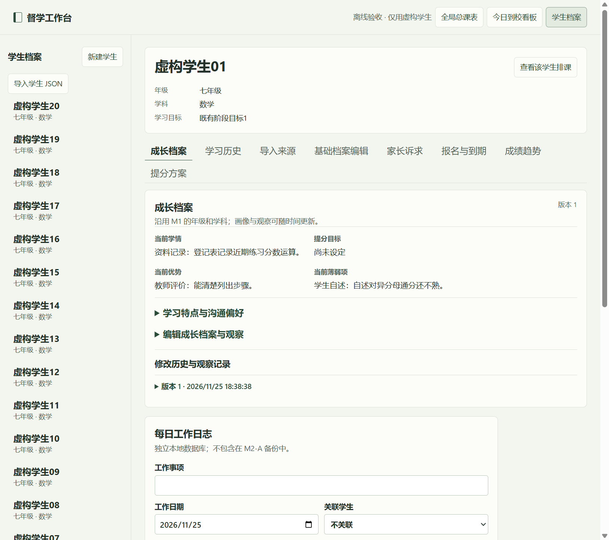
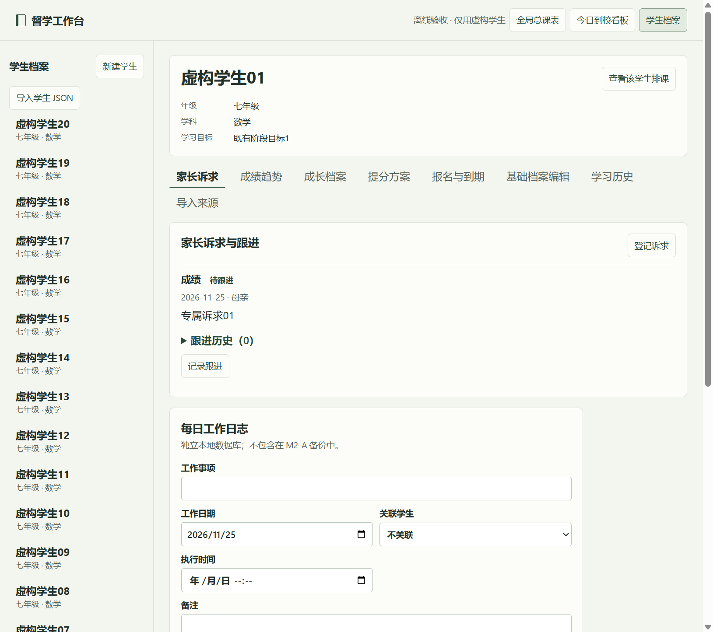

# Phase 2 学生档案导航与隔离验收

基线：重新核实的 main `a1e5a3b49fe50a8a7db75d219d351e82f9680911`。本分支不叠加 Phase 1A，不改变成绩图逻辑，可单独审查和回退。

## 最终界面

启用的模块按家长诉求、成绩趋势、成长档案、提分方案、报名与到期、基础档案编辑、学习历史、导入来源排列。原有排课快捷入口保留。没有对应版本能力的模块不显示入口，也不显示规划占位导航。

首次进入或切换学生时默认使用首个可用模块：优先家长诉求，其次成绩，成长档案可作为旧版回退。同一学生显式选择的页签在保存刷新时保留。选择状态绑定学生 ID，直接在渲染时推导有效页签，不通过新增 key 或强制卸载详情树来清空状态。

现有业务面板及其学生 key 保持原样，未保存输入继续由原有切换确认、busy 及持久待核对凭据机制保护。没有改动这些保护实现。

| 调整前实际应用 | 调整后实际应用 |
| --- | --- |
|  |  |

## 测试与 Windows 验收

原有 116 项测试不改，新增 3 项导航、能力回退及面板保留回归，合计 119/119。类型检查、生产构建、Windows x64 打包通过。原组件导航排序回归失败，候选通过。

`scripts/profile-acceptance.cjs` 对实际 packaged Electron 建立新合成数据根并核对运行时 userData。启动必须等待导航启用，再断言档案实际可见，避免把隐藏的 DOM 当成可见界面。脚本没有系统剪贴板读写。

实际验证包括：20 名虚构学生；家长诉求默认与八项导航排序；既有学习历史及真实合成 JSON 导入来源仍可查看；成绩与排课快捷入口；基础编辑保存后同一学生不跳页；家长草稿跨页签保留且取消学生切换不丢失；保存忙碌时不能切换；提交后回执丢失时持久待核对请求仍在、阻止新写入，确认后恢复；三类旧学生响应延迟后切换不会混入新学生。另以实际 M1 v1 合成档案验证成长档案、历史、来源三个入口及默认回退。

20 人切换时间包含本机读取对应学生诉求直到下一帧可用，原始测量值保留在本地验收 JSON；不把单机结果当作所有硬件的性能承诺。测试脚本与截图均使用虚构数据，正式学生档案没有参与。

## 轻量概览评估

本轮保留身份卡现有学习目标与备注，没有新增概览查询或摘要缓存。新增跨模块概览单独作为后续 UI 数据流设计任务，当前不实现：

| 内容 | 现有权威数据 | 后续方案与约束 |
| --- | --- | --- |
| 家长核心诉求 | parentFollowUp 的多条诉求与跟进 | 当前没有核心/置顶标记，不能静默把最新一条改称核心。先确认摘要选择规则，再由既有面板读取结果向概览传递只读数据 |
| 最近成绩和得分率趋势 | studentRecords(score) 与成绩组件 | 按学科和考试日期计算，不能把不同科目混成最近成绩。复用面板已读数据，带 studentId、刷新版本和读取状态，避免再维护一套查询缓存 |
| 既有阶段目标 | student.goal、成长目标、提分方案 | 保留不同字段的原语义，身份卡继续显示已有学习目标，不覆盖成长历史或提分方案 |
| 当前督学重点 | 无专门可靠字段 | 未填写，不从普通备注、知识薄弱项或分数虚构行动。字段语义需要独立确认 |

这些摘要不必新增数据库或 IPC，但需要跨组件只读结果通知、来源选择、刷新失效与迟到响应策略。当前主交付保持在单一 StudentDetail 信息组织；后续可独立评审 render prop/回调方案。缺失或读取失败必须明确展示，禁止生成学生表现或重复存储。

## 兼容性与联合候选

唯一生产源码修改为 StudentDetail.tsx；没有数据库、IPC、成绩 payload、备份格式、业务写入或排课规则修改。schema 和旧备份恢复兼容性沿用 main，原基线迁移与恢复测试保留。

Phase 1A 的成绩组件/计算修复与本分支的导航修改不重叠。联合候选应以核实的 main 为基础，组合分别固定的两个 diff，在全新合成档案重跑类型、联合测试、构建和两套业务验收。此方案不包含 #15 维护候选，不代表 #15 的风险已解决。正式合并、发布、升级继续 HOLD。
